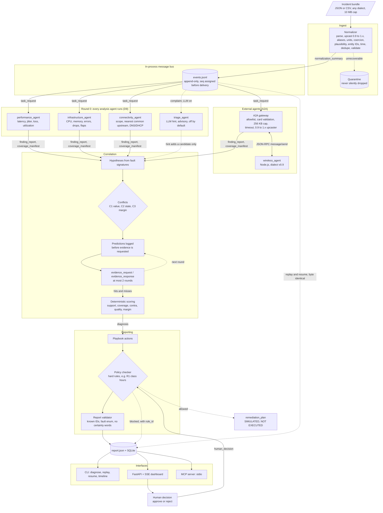
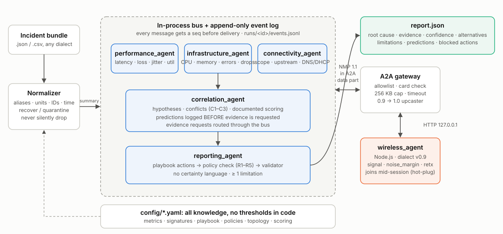
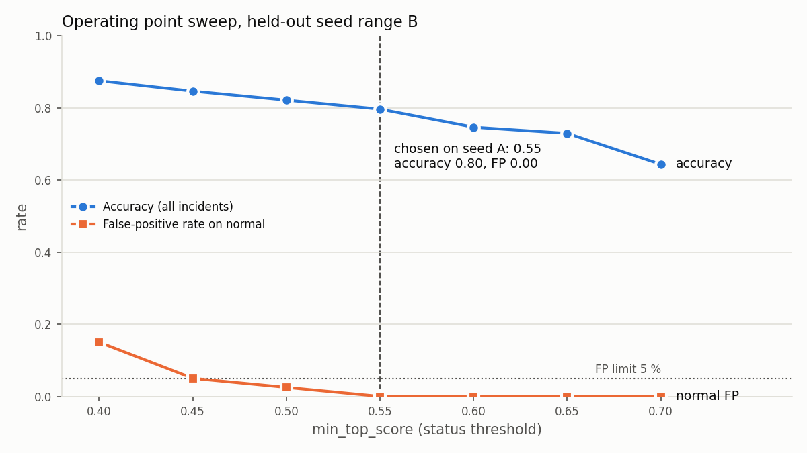

# NetCoop AI: multi-agent network fault diagnosis

[](https://github.com/omadityajha01/NetCoop-AI/actions/workflows/ci.yml)

## 1. Overview

NetCoop AI is a deterministic multi-agent system for campus network fault diagnosis (IIT Bhubaneswar scenario,
synthetic telemetry). Specialized agents exchange typed findings over a documented protocol (**NMP 1.4**), test
competing hypotheses by requesting discriminating evidence from each other, and emit **one JSON diagnostic report**:
root cause, supporting evidence (traceable to `finding_id`s), alternative causes, a documented confidence score,
limitations, and policy-checked recommendations.

> **Transport: A2A (borrowed). Semantics: NMP + metric registry (designed).**

**Design goals**

1. **Hot-plug interoperability.** `wireless_agent` (Node.js, legacy dialect **v0.9**, its own field names) joins at
   runtime over A2A, passes the conformance kit, and **changes the outcome**: Wi-Fi goes from `insufficient_evidence`
   to `diagnosed`.
2. **Predict before you look.** Hypotheses log falsifiable predictions to the event log *before* evidence is requested
   (enforced by `seq`); hits and misses are scored and every prediction is reported.
3. **Measured, not claimed.** Per-fault accuracy, confusion matrix, calibration, severity sweep and degradation curves
   come from `make eval` / `make fuzz` on generated incidents (held-out seed range B), never from demo fixtures.

**Decision boundary.** Root cause, confidence, conflict resolution and actions are computed by code. The LLM is
optional and **off by default**: it may add a candidate hypothesis and write the narrative, nothing else.

### Scenarios (sample data)

| Scenario | File | Expected outcome |
|---|---|---|
| Normal operation | `data/scenarios/normal/incident.json` | `no_fault_detected` |
| Link congestion | `data/scenarios/congestion/incident.json` | `diagnosed` congestion on `L_HOSTEL_UPLINK`; reboot blocked by R1 (class hours) |
| Weak Wi-Fi | `data/scenarios/weak_wifi/incident.json` | `insufficient_evidence` → `diagnosed` once `wireless_agent` joins |
| Interface fault | `data/scenarios/interface_fault/incident.json` | `diagnosed` interface fault on `L_DEPT_ACC_01`; disruptive actions blocked by R4 (exams) |
| DNS failure | `data/scenarios/dns_failure/incident.json` | `diagnosed` DNS failure on `DNS_01`; L3 latency/loss predicted normal → hits |
| DHCP failure | `data/scenarios/dhcp_failure/incident.json` | `diagnosed` DHCP failure on `DHCP_01` |
| Interoperability failure | `data/scenarios/interop/incident.json` | `diagnosed` device overload on `DEPT_CORE_SW_01` from mixed dialects, units, IDs, a legacy v0.9 block, garbage and an injection attempt |

`python -m eval.generate --fixtures` regenerates all fixtures deterministically. The organizer's Colab generator is
exported verbatim to `data/generator/organizer_generator.py`, and its field contract is in `data/generator/SCHEMA.md`.
Its output (`cpu_utilization_pct`, `queue_drops`, `interface_errors`, `status`, …) is accepted as-is.

### Known limitations

* All telemetry is synthetic. The topology in `config/topology.yaml` is a NetCoop-defined model of the campus,
  and thresholds and weights are tuned on generated data.
* The eval generator is ours, so accuracy measures internal consistency under realistic noise, not field performance.
* The core speaks A2A wire shapes over stdlib HTTP rather than embedding `a2a-sdk`. Compatibility is verified
  against the official SDK v1.3.0 in an optional test (it pulls protobuf ≥ 6, so it is kept out of the default install).
* The optional LLM paths (Ollama / cloud API) run in CI only with a mocked model. The live tests (`tests/llm_live`,
  marker `llm_live`) are opt-in and need a local model.

---

## 2. Architecture

### System workflow

Single incident, end to end. Solid edges are NMP messages on the bus; dotted edges are optional or post-run paths.





<sub>Diagram source: [`docs/architecture.mmd`](docs/architecture.mmd) (Mermaid); the SVG is hand-rendered from it, with no scripts and no external fonts.
Video voiceover: [`docs/VIDEO_SCRIPT.md`](docs/VIDEO_SCRIPT.md).</sub>

### Component view

```
                 incident bundle (.json/.csv, any dialect)
                                 │
                       ┌─────────▼─────────┐
                       │    normalizer     │  parse → version/upcast → aliases → units → coercion →
                       │  (recover / quar- │  plausibility → entities → time → dedupe → validate
                       │  antine, never    │  every step = Transform; never silently drop, never invent
                       │  silently drop)   │
                       └─────────┬─────────┘
                                 │ normalization_summary
 ┌───────────────────────────────▼──────────────────────────────────────────────────────────┐
 │  in-process message bus ── every message appended to runs/<id>/events.jsonl (seq) first │
 │                                                                                          │
 │  performance_agent   infrastructure_agent   connectivity_agent    correlation_agent      │
 │  (latency, loss,     (CPU, mem, errors,     (scope, nearest       (hypotheses, conflicts,│
 │   util, jitter)       drops, flaps, up)      upstream, DNS/DHCP)   predictions, scoring)  │
 │                                                                    reporting_agent        │
 │                                                                    (playbook, policy, PS  │
 │                                                                     report, limitations)  │
 └──────────────────────────────────────┬───────────────────────────────────────────────────┘
                                        │ NMP envelope inside an A2A data part (JSON-RPC message/send)
                              ┌─────────▼──────────┐   allowlist-only discovery, card validation,
                              │   A2A gateway      │   size cap 256 KB, timeout, rate limit,
                              │ + 0.9→1.0 upcaster │   same normalizer, no tools, never in prompts
                              └─────────┬──────────┘
                                        │ HTTP
                              ┌─────────▼──────────┐
                              │  wireless_agent    │  Node.js, dialect v0.9:
                              │  ("wifi-probe")    │  {"ver":"0.9","obs":[{"ap":"ap-h3","signal":-78,...}]}
                              └────────────────────┘
```

#### Agent responsibilities

| agent_id | Owns | Where |
|---|---|---|
| `performance_agent` | latency, jitter, packet loss, throughput, link utilization | internal |
| `infrastructure_agent` | device status, CPU, memory, interface/CRC errors, link flaps, egress queue drops | internal |
| `connectivity_agent` | DNS/DHCP service health; scope of impact + nearest common upstream node | internal |
| `wireless_agent` | RSSI, SNR, retransmissions, client count per AP | **external** (Node.js, A2A, dialect v0.9) |
| `correlation_agent` | hypotheses, conflict detection (C1–C3), predictions, evidence requests, scoring | internal |
| `reporting_agent` | PS-format report, playbook actions, policy check, limitations | internal |

Agents are **pure**: messages in, messages out. They never call each other, keep no global state, and do I/O
only through the read-only tools granted in `config/agents.yaml` (`telemetry`, `topology`, `findings`).
Every threshold, alias and weight comes from `config/`. All analysis agents always run; nothing can skip one.

**Round-0 rule:** in the first pass, analysis agents publish only anomalous findings (severity ≥ warn) plus a
coverage manifest. Normal values are available only through `evidence_request`. This keeps predictions honest:
a prediction is made before the agent shows the value.

### Communication interfaces

Agents talk only through typed NMP messages on the bus, and through A2A for external agents. See [Protocol: NMP 1.4](#protocol-netcoop-message-protocol-nmp-14) (envelope, finding, metric registry, versioning) and [A2A transport](#a2a-transport).

### Protocol: NetCoop Message Protocol (NMP) 1.4

Minor versions are additive: 1.1 added `normalization_summary`, 1.2 the advisory LLM `hint`, 1.3 `human_decision`
(a non-blocking HITL record appended after the report), and 1.4 `remediation_plan`, a dry-run for an approved,
policy-allowed action, labelled "SIMULATED – NOT EXECUTED". None of these is executed or changes the diagnosis.

Pydantic v2 models (`netcoop/protocol/`) are the source of truth. `make schemas` exports JSON Schemas to
`docs/schemas/`, and external agents should be pointed at those, not at the Python. The tables below are
generated from config by `make docs`.

#### Envelope (every message)

<!-- BEGIN GENERATED: envelope -->
| Field | Type | Meaning |
|---|---|---|
| `schema_version` | "MAJOR.MINOR" | Protocol version of this message (current 1.4; older 1.x accepted; 0.9 upcast) |
| `message_id` | uuid | Unique; receivers are idempotent on duplicates (content-derived UUIDv4) |
| `message_type` | enum | `task_request`, `finding_report`, `coverage_manifest`, `prediction`, `evidence_request`, `evidence_response`, `diagnosis`, `report`, `error`, `normalization_summary`, `hint`, `human_decision`, `remediation_plan` |
| `incident_id` | str | Server-generated, `^INC-[0-9A-Z]{4,12}$` |
| `sender / recipient` | agent_id | `recipient` may be `orchestrator` |
| `in_reply_to` | uuid | null | `message_id` this responds to |
| `seq` | int | Assigned by the event log on append (monotonic per run); agents never set it |
| `created_at` | RFC3339 UTC | Stamped by the event log on append |
| `status` | enum | `completed`, `partial`, `failed`, `insufficient_data` |
| `payload` | object | Typed per `message_type` (see docs/schemas/) |
| `limitations` | list[Limitation] | `{code, detail, impact}` |
| `extras` | object | Unknown fields from newer MINOR versions, kept (never silently dropped) |
<!-- END GENERATED: envelope -->

Payloads per `message_type`: `task_request {task, window, round, params}`, `finding_report {round, findings[], scope?}`,
`coverage_manifest {signals[{metric, entity}]}`, `prediction {prediction}`, `evidence_request {round, requests[{metric, entity, window}], prediction_ids}`,
`evidence_response {round, findings[], unavailable[]}`, `diagnosis {phase, status, hypotheses[], conflicts[], predictions[], …}`,
`report {report}`, `error {code, detail, offending_message_id, field, agent_id}`, `normalization_summary {…}`.
Error codes: `SCHEMA_VERSION_UNSUPPORTED, MISSING_FIELD, BAD_TYPE, BAD_UNIT, UNKNOWN_ENTITY, MALFORMED, TIMEOUT, TOO_LARGE, AGENT_FAILED, INVALID_OUTPUT, RATE_LIMITED`.

#### Finding

<!-- BEGIN GENERATED: finding -->
| Field | Type | Meaning |
|---|---|---|
| `finding_id` | str | `F-<agent>-<n>`, unique per run |
| `metric` | str | Canonical name; must exist in `metrics.yaml` |
| `entity` | EntityRef | `{type, id}`; type ∈ device, link, ap, service; id exists in topology |
| `value` | float | Aggregated value, canonical unit |
| `unit` | str | Canonical unit from `metrics.yaml` |
| `window` | Window | `{start, end}` UTC span of the samples used |
| `aggregation` | Literal | p95, mean, max, count, rate (from `metrics.yaml`) |
| `sample_count` | int | Samples aggregated |
| `threshold_ref` | str | e.g. `metrics.yaml#latency_ms.wireless.high` or `policies.yaml#R2.high` |
| `severity` | Literal | normal, warn, high, critical: derived from thresholds only |
| `data_quality` | DataQuality | `{completeness 0–1, staleness_s, coerced}` |
| `transforms` | list | Every normalization step applied to the underlying data |
| `source_refs` | list | Raw record references (`records[i].field`) |
| `source` | str | None | Originating telemetry source (snmp, probe, wifi-probe…); used for C1 conflicts |
| `placed` | bool |  |
<!-- END GENERATED: finding -->

#### Metric registry (`config/metrics.yaml`): names, units, meanings, aliases, thresholds

<!-- BEGIN GENERATED: metrics -->
| Metric | Unit | Aggregation | Direction | Range | Thresholds warn/high/critical | Aliases | Meaning |
|---|---|---|---|---|---|---|---|
| `latency_ms` | ms | p95 | higher is worse | 0–60000 | default: 50 / 150 / 500; wireless: 80 / 200 / 600 | `rtt_ms`, `delay_ms`, `ping_ms`, `latency_msec`, `avg_latency_ms`, `latency`, `rtt`, `delay`, `ping` | Round-trip time probe->entity, aggregated over the window |
| `jitter_ms` | ms | p95 | higher is worse | 0–60000 | default: 15 / 30 / 80; wireless: 25 / 50 / 100 | `jitter_msec`, `pdv_ms`, `jitter`, `pdv` | Variation in latency (mean absolute delta between consecutive probes) |
| `packet_loss_pct` | pct | mean | higher is worse | 0–100 | default: 1 / 3 / 10; wireless: 2 / 5 / 15 | `loss_pct`, `packet_loss_percent`, `pkt_loss_pct`, `packetloss_pct`, `packet_loss`, `loss`, `pkt_loss`, `packetloss` | Share of probe packets lost in the window |
| `throughput_mbps` | mbps | mean | lower is worse | 0–400000 | default: 20 / 5 / 1 | `throughput_mbit`, `bandwidth_mbps`, `goodput_mbps`, `throughput`, `bandwidth`, `goodput` | Measured goodput across the entity in the window |
| `link_utilization_pct` | pct | p95 | higher is worse | 0–100 | default: 70 / 85 / 95 | `utilization_pct`, `util_pct`, `link_util_pct`, `bandwidth_utilization_pct`, `if_util_pct`, `utilization`, `util`, `link_util`, `link_utilization` | Egress utilization of the link relative to its capacity |
| `cpu_pct` | pct | p95 | higher is worse | 0–100 | default: 70 / 85 / 95 | `cpu_utilization_pct`, `cpu_util_pct`, `cpu_usage_pct`, `cpu_percent`, `cpu`, `cpu_util`, `cpu_usage`, `cpu_load` | Control-plane CPU utilization of the device |
| `memory_pct` | pct | p95 | higher is worse | 0–100 | default: 75 / 90 / 97 | `memory_utilization_pct`, `mem_pct`, `mem_util_pct`, `memory_usage_pct`, `memory`, `mem`, `mem_usage` | Memory utilization of the device |
| `queue_drops_count` | count | max | higher is worse | 0–100000000 | default: 50 / 100 / 1000 | `queue_drops`, `egress_drops`, `egress_queue_drops`, `output_drops`, `qdrops` | Packets dropped from egress queues per sample interval |
| `interface_errors_count` | count | max | higher is worse | 0–100000000 | default: 10 / 50 / 200 | `interface_errors`, `if_errors`, `iface_errors`, `port_errors`, `input_errors` | Input+output interface errors per sample interval |
| `crc_errors_count` | count | max | higher is worse | 0–100000000 | default: 5 / 20 / 100 | `crc_errors`, `crc`, `fcs_errors` | Frames with bad CRC per sample interval |
| `link_flaps_count` | count | max | higher is worse | 0–100000 | default: 1 / 3 / 10 | `link_flaps`, `flaps`, `flap_count`, `link_state_changes` | Link up/down transitions per sample interval |
| `device_up` | bool | mean | lower is worse | 0–1 | default: 0.99 / 0.5 / 0 | `device_status_up`, `is_up`, `up` | 1 if the device reported up in the sample, 0 if down; window value is the mean |
| `rssi_dbm` | dbm | p95 | lower is worse | -120–0 | wireless: -67 / -75 / -85; default: -67 / -75 / -85 | `rssi`, `signal`, `signal_dbm`, `signal_strength_dbm` | Received signal strength of clients at the AP |
| `snr_db` | db | p95 | lower is worse | -20–90 | wireless: 25 / 15 / 8; default: 25 / 15 / 8 | `snr`, `noise_margin`, `noise_margin_db` | Signal-to-noise ratio of clients at the AP |
| `retransmission_pct` | pct | mean | higher is worse | 0–100 | wireless: 10 / 20 / 40; default: 10 / 20 / 40 | `retransmissions_pct`, `retry_pct`, `retx_pct`, `retry_rate_pct`, `retx`, `retransmissions`, `retries`, `retry_rate` | Share of 802.11 frames retransmitted at the AP |
| `client_count` | count | max | higher is worse | 0–2000 | wireless: 40 / 60 / 90; default: 40 / 60 / 90 | `clients`, `num_clients`, `associated_clients`, `sta_count` | Number of clients associated to the AP |
| `dns_failure_pct` | pct | mean | higher is worse | 0–100 | default: 2 / 10 / 40 | `dns_fail_pct`, `dns_error_pct`, `dns_failure_rate_pct`, `dns_failure_rate`, `dns_failures` | Share of DNS queries that failed or timed out (synthetic probe) |
| `dhcp_failure_pct` | pct | mean | higher is worse | 0–100 | default: 2 / 10 / 40 | `dhcp_fail_pct`, `dhcp_error_pct`, `dhcp_failure_rate_pct`, `dhcp_failure_rate`, `dhcp_failures` | Share of DHCP DISCOVER/REQUEST exchanges that did not complete |
<!-- END GENERATED: metrics -->

"Aliases" whose name implies the unit (`rtt_ms`) map directly. "Ambiguous" aliases (`latency`, `rtt`, `utilization`)
need an explicit unit (a suffix like `"0.28s"` or a `units` map), or **batch-level** inference. A unit is inferred
only if exactly one unit keeps every value in the batch plausible, or if a `*_pct` metric has every value in [0,1].
It is never inferred from a single value. Otherwise the field is quarantined.

#### Versioning

Current version: **1.1**. It is a MINOR bump over 1.0 and purely additive:
* `Finding.source`
* the report fields `observations` and `status_reason`
* the `normalization_summary` message type

1.0 messages are accepted unchanged. The external `wireless_agent` still speaks 0.9 and is upcast.

* **MINOR bump:** accepted. Unknown fields go to `extras` with a warning limitation.
* **MAJOR mismatch:** the registered upcaster chain runs (`upcasters.py`, `0.9 → 1.0`). With no upcaster the reply is `error SCHEMA_VERSION_UNSUPPORTED`.
* **Missing `schema_version`:** shape detectors (`1.0` envelope shape, `0.9` `from`+`obs` shape) apply, and the version is logged as inferred.

**Dialect 0.9 → 1.0** (the `wireless_agent` speaks it; *do not fix it*):

| 0.9 | 1.0 | How |
|---|---|---|
| `ver` / `inc` / `from` / `re` | `schema_version` / `incident_id` / `sender` / `in_reply_to` | upcaster |
| `obs[]` | `payload.observations[]` (normalized → findings by the gateway) | upcaster |
| `signal` | `rssi_dbm` | metric registry alias |
| `noise_margin` | `snr_db` | metric registry alias |
| `retx` (fraction) | `retransmission_pct` (×100) | upcaster declares unit `fraction`; `unit_aliases` converts |
| `ts` (epoch s) | RFC3339 UTC | upcaster |
| `ap-h3` | `AP_H3` | topology alias (case/separator-insensitive) |
| `dev`, `rtt` (s), `loss`, `cpu` (fractions) | `device_id`, `latency_ms`, `packet_loss_pct`, `cpu_pct` | legacy wired probes |

#### A2A transport

**A2A-compatible (verified with a2a-sdk v1.3.0).** The official `a2a-sdk` client resolves the Node
`wireless_agent`'s card and completes a `message/send` round trip; NetCoop's parser then accepts the reply
(`tests/a2a_sdk`, optional: `pip install -e .[a2a]`). Note: SDK 1.3 targets the A2A 1.0 spec and reads our
0.3-style card (`url` + `protocolVersion`) through its backward-compatibility path.

The gateway (`netcoop/gateway/`) uses A2A wire shapes over stdlib HTTP, so the offline core needs no SDK:
* the Agent Card at `<base>/.well-known/agent-card.json`
* JSON-RPC 2.0 `message/send`
* the NMP envelope in `Message.parts[{kind:"data"}]`

Card skills map to NMP capabilities through `config/agents.yaml` (`wifi-rf-telemetry → metric:rssi_dbm, …`).
Discovery is **only** from that allowlist, and a card whose `url` leaves the allowlisted origin is rejected.

**Conformance kit:** `make conformance AGENT_URL=…`, or `pytest conformance/` with `AGENT_URL` set. It checks that the agent:
* serves a valid card
* answers `task_request` and `evidence_request` with valid NMP within the timeout
* returns an `error` on malformed input
* is idempotent on a duplicate `message_id`
* declares `schema_version`
* tolerates unknown fields and a newer MINOR version

### Workflow

One incident, end to end (details in [Orchestration](#orchestration)):

1. **Ingest → normalize** the bundle (aliases, units, IDs, time; quarantine, never silently drop).
2. **Round 0:** `task_request` to all analysis agents in parallel, plus any allowlisted external agent that is reachable now.
3. **Scope:** `connectivity_agent` finds affected entities and the nearest common upstream node.
4. **Correlate:** `correlation_agent` builds hypotheses, detects conflicts, and logs predictions *before* requesting evidence.
5. **Evidence rounds** (≤ 2) answer the predictions; hits and misses are scored.
6. **Final scoring → report:** playbook actions, policy check and validator.
7. **Persist** `report.json` + the append-only `events.jsonl` (replayable byte for byte).

### Orchestration

1. **Ingest → normalize**, which emits `normalization_summary`.
2. **Round 0:** `task_request` goes to *all* analysis agents in parallel: internal agents plus every allowlisted external agent that is reachable now (hot-plug). Timeouts come from `agents.yaml`, with one retry.
3. `connectivity_agent` computes the **scope**: affected entities, devices, segments and the nearest common upstream node.
4. `correlation_agent` builds hypotheses from anomalous findings, scope and (optional) hints. It detects conflicts, then logs predictions and evidence requests.
5. **Evidence rounds:** at most 2 rounds, at most 3 predictions and 6 evidence requests per round. A second round runs only while the case is unresolved (insufficient, probable, margin < 0.15, or an unresolved C2).
6. **Final scoring** produces `diagnosis`. Then `reporting_agent` runs playbook → policy check → report, and the **validator** checks it before anything is written.
7. `report.json`, `events.jsonl`, `input.*`, `meta.json` and `external.jsonl` are written under `runs/<incident_id>/`, and the report is also stored in SQLite.

State is **derived from the event log**. `seq` is assigned on append, before delivery. Message ids are
content-derived UUIDv4s. `netcoop replay <id>` re-runs from the stored input plus the recorded external
exchanges, and checks that `report.json` and the event sequence are byte-identical.

#### Conflict resolution

| Type | Detection | Resolution |
|---|---|---|
| **C1 value** | Same metric + entity from different sources, overlapping windows, relative difference > 20% | Keep the fresher value, then the higher `sample_count`, then `source_priority`. The loser goes to limitations and is excluded from scoring |
| **C2 state** | A device reports `down` but has newer telemetry; or metrics arrive for links absent from topology | Mark the status stale (quality 0.5) and send one re-fetch `evidence_request`. If still unresolved, confidence is capped. Unknown links are quarantined (topology is never invented) |
| **C3 hypothesis** | margin(top, second) < 0.15 | Prediction rounds. If still < 0.15: `probable` with both co-candidates plus the missing discriminating data |

#### Failure handling

* An analysis agent that times out, crashes or returns invalid output (after one retry) is marked `failed` and an `error` message is logged. The run continues, the report gets "`<agent>` failed: `<reason>`", and the confidence category is capped at medium.
* If correlation fails, the report has status `failed` but still contains the raw anomalous findings.
* Malformed input fails safely with a `failed` report that explains why (`MALFORMED`, `TOO_LARGE`, `SCHEMA_VERSION_UNSUPPORTED`, …).
* Every loop is bounded by config: rounds, requests per round, and a total bus message cap.

### Evidence correlation

How findings from different agents are combined into one diagnosis: see [Correlation and scoring (documented method)](#correlation-and-scoring-documented-method).

### Correlation and scoring (documented method)

Fault signatures (`config/signatures.yaml`):

<!-- BEGIN GENERATED: signatures -->
| fault_type | Report label | Expects (op ref ×weight) | Contradicts | Entity |
|---|---|---|---|---|
| `congestion` | Likely link congestion causing egress queue drops | `link_utilization_pct` >= high ×3, `queue_drops_count` >= high ×3, `latency_ms` >= warn ×2, `packet_loss_pct` >= warn ×1 | `interface_errors_count` >= high ×2, `cpu_pct` >= high ×1 | link, device |
| `interface_fault` | Likely physical interface fault causing errors and packet loss | `interface_errors_count` >= high ×3, `crc_errors_count` >= warn ×2, `link_flaps_count` >= warn ×2, `packet_loss_pct` >= warn ×2 | `link_utilization_pct` >= high ×2 | link, device |
| `device_overload` | Likely device overload (CPU exhaustion) causing drops across interfaces | `cpu_pct` >= warn ×3, `queue_drops_count` >= high ×2, `memory_pct` >= warn ×1, `latency_ms` >= warn ×1 | `link_utilization_pct` >= critical ×2, `interface_errors_count` >= high ×1 | device |
| `weak_wifi` | Likely weak Wi-Fi signal at the access point causing retransmissions | `rssi_dbm` <= warn ×3, `snr_db` <= warn ×2, `retransmission_pct` >= warn ×3, `latency_ms` >= warn ×1, `packet_loss_pct` >= warn ×1 | `link_utilization_pct` >= high ×2, `client_count` >= high ×1 | ap |
| `dns_failure` | Likely DNS service failure causing name-resolution errors | `dns_failure_pct` >= high ×4 | `latency_ms` >= high ×2, `packet_loss_pct` >= high ×2 | service |
| `dhcp_failure` | Likely DHCP service failure preventing new address leases | `dhcp_failure_pct` >= high ×4 | `latency_ms` >= high ×2, `packet_loss_pct` >= high ×2 | service |
| `latency_spike` | Likely latency spike (high latency and jitter without congestion, interface errors or overload) | `latency_ms` >= high ×3, `jitter_ms` >= high ×3 | `queue_drops_count` > warn ×2, `link_utilization_pct` >= high ×2 | device |
| `hardware_failure` | Likely device hardware failure (every resource saturated, interface errors and heavy loss) | `interface_errors_count` >= high ×3, `cpu_pct` >= critical ×2, `link_utilization_pct` >= critical ×2, `packet_loss_pct` >= critical ×2, `queue_drops_count` >= critical ×2, `latency_ms` >= critical ×1 |  | device |
<!-- END GENERATED: signatures -->

Signals are matched on the hypothesis entity and its topology neighbours (link ↔ endpoints, AP ↔ uplink,
service ↔ host switch). For each fault type the best-localized candidate entity is kept; on ties the more
specific type wins (link before device).

```
support  = Σ w_s [s ∈ E observed & matches]  / Σ w_s [s ∈ E]
coverage = Σ w_s [s ∈ E observed]            / Σ w_s [s ∈ E]
contra   = Σ w_c [c ∈ C observed & present]  / max(Σ w_c [c ∈ C], 1)
quality  = max(0.5, mean(completeness of used findings) − 0.05 × n_coerced_used)
score    = clamp(support − contra_penalty × contra, 0, 1) × quality
margin   = score(top) − score(second)
```

Completeness is `samples / min(window / interval, cadence)`, where cadence is the most samples any signal has in this input, so a one-record snapshot counts as complete. It is capped at 0.5 for stale data (older than 900 s).

| Condition (in order) | Status |
|---|---|
| no usable observations, **or** coverage(top) < 0.50 | `insufficient_evidence` (`status_reason: data_missing`) + the exact missing signals |
| coverage ok, **no** finding ≥ `high`, top score < `min_top_score` (0.55) | `no_fault_detected`; warn-level readings listed under `observations` (not evidence) |
| coverage ok, **some** finding ≥ `high`, top score < `min_top_score` (0.55) | `insufficient_evidence` (`status_reason: no_signature_match`) |

A lone `high` reading counts as an *observation*, not as "a finding ≥ high", when all of these hold:
* it is the only anomalous signal on its entity
* it is below 1.25× its `high` threshold
* its metric is not marked `sufficient_alone` (DNS/DHCP failure rates are)

A single busy link or CPU blip therefore does not block `no_fault_detected`. It is still listed in the report.
| margin < 0.15 after prediction rounds | `probable`, top 2 reported as co-candidates |
| otherwise | `diagnosed` (wording stays "Likely …") |

`confidence` = score(top), rounded to 2 dp. `confidence_category` is `high` if ≥ 0.75 and margin ≥ 0.25,
`medium` if ≥ 0.50, otherwise `low`. Any `failed` agent or unresolved C2 conflict caps it at `medium`. For
`no_fault_detected`, confidence = (1 − best fault score) × the share of analysis agents that reported coverage.

**Predictions (P1–P5):**
* A prediction may only reference a signal not yet in that hypothesis's evidence.
* It is appended to the log **before** its evidence request.
* Scoring rejects any prediction whose `seq` is after its evidence response (tested by tampering with the log).
* Discriminating signals come first: signals the top two hypotheses expect in opposite directions.
* Hits and misses enter scoring as ordinary observed evidence, and `unknown` becomes a limitation.

Final constants (`config/scoring.yaml`; tuned on seed range A only):

<!-- BEGIN GENERATED: constants -->
| Constant | Value |
|---|---|
| contra_penalty | 1.0 |
| quality_floor | 0.5 |
| coerced_penalty | 0.05 |
| stale_quality | 0.5 |
| status.min_top_score | 0.55 |
| status.min_top_coverage | 0.5 |
| status.uncorroborated_high_ratio | 1.25 |
| status.min_margin | 0.15 |
| confidence.high_min | 0.75 |
| confidence.high_min_margin | 0.25 |
| confidence.medium_min | 0.5 |
| conflicts.c1_relative_diff | 0.2 |
<!-- END GENERATED: constants -->

### Error handling

Agent failures (timeouts, crashes, invalid output) are covered in [Failure handling](#failure-handling); bad or incompatible input in [Error handling and robustness](#error-handling-and-robustness-normalization-pipeline) below.

### Error handling and robustness (normalization pipeline)

Runs in this order, and every step records `Transform{step, field, from, to, reason}`:

1. **Parse:** stdlib JSON/CSV, 10 MB cap; non-UTF-8 → `MALFORMED`.
2. **Version:** detect → upcast (embedded v0.9 blocks inside bundles are expanded too).
3. **Field aliases** from `metrics.yaml`. Unknown fields → `extras` + warning. The generator's `status` label is kept but never used as evidence.
4. **Units:** explicit unit → `unit_aliases`; missing → batch inference only; otherwise quarantine.
5. **Coercion:** `"280ms"` → 280 ms. `"N/A"`, `""`, `null` and `NaN` → **missing, never 0**.
6. **Plausibility:** an out-of-range value (negative latency, utilization > 100, RSSI > 0) quarantines the record.
7. **Entities:** PI6 regex, then topology aliases (case- and separator-insensitive, IPs too).
   * An unknown **device** is kept *unplaced*. Its findings carry `placed=false`, no links or upstream are invented,
     localization is skipped, and the "device not in topology" limitation is added. The confidence category is capped at medium if the diagnosis involves it.
   * Unknown links, APs and services → quarantine + `UNKNOWN_ENTITY`.
   * A `topology` object in the input bundle (same shape as `config/topology.yaml`) is validated and merged
     additively. On a conflicting attribute, config wins and the conflict is listed in limitations, so incident data
     cannot, for example, demote a core switch to dodge a policy rule. An invalid topology is rejected with a limitation.
8. **Time:** everything to UTC (epoch s/ms, offsets, naive → UTC + logged). More than 5 min in the future → quarantine. Older than the window → counted. Staleness is computed relative to the incident time.
9. **Dedupe** on (entity, metric, timestamp, source).
10. **Validate** against the Pydantic models.

Invariant (tested, and property-tested with `hypothesis`): `records_in == records_used + records_quarantined`.
Every coercion sets `data_quality.coerced`, lowers quality, and appears in `limitations`.

### Report format

The PS fields are kept exactly: `incident_id, status, suspected_root_cause, confidence, affected_devices,
supporting_evidence, alternative_causes, recommended_actions, evidence_sources, limitations`.
These extensions are additive:
* `schema_version`, `fault_type`, `confidence_category`, `status_reason` (`data_missing` | `no_signature_match`)
* `observations` (warn-level readings not used as evidence)
* `scoring{support, coverage, contra, quality, score, margin}`
* `co_candidates`, `rejected_alternatives`, `predictions`
* `blocked_actions` (with `rule_id`), `action_details`
* `missing_signals`, `conflicts`, `agents`
* `normalization_summary`, `narrative`

`status` ∈ `diagnosed | probable | insufficient_evidence | no_fault_detected | failed`.

---

## 3. Key Features

| Capability | Implementation |
|---|---|
| Multi-agent diagnosis | 6 specialized agents on one logged bus. Pure functions, no shared state; every threshold and weight comes from `config/` |
| Documented protocol | NMP 1.4 (Pydantic v2 → JSON Schema in `docs/schemas/`), metric registry, versioning with upcasters (0.9 → 1.x) |
| Hot-plug interoperability | Node.js `wireless_agent` joins over A2A at runtime, passes a 7-check conformance kit, and changes the diagnosis |
| Predict before you look | Falsifiable predictions are logged before evidence is requested, enforced by `seq` ordering; hits and misses are scored |
| Deterministic, replayable core | Same input → byte-identical report; `netcoop replay` and `netcoop resume` rebuild runs from `events.jsonl` |
| Robust normalization | Recover, quarantine, never silently drop; every coercion recorded as a `Transform`; property- and fuzz-tested |
| Measured accuracy | Per-fault accuracy, confusion matrix, calibration, degradation curves, all on held-out seed range B |
| Safety by construction | Policy-checked playbook actions, human-approved dry-run remediation (never executed), prompt-injection controls ([Guardrails](#guardrails-and-security)) |
| Interfaces | CLI, FastAPI + SSE dashboard (strict CSP), MCP server, mock API + recorded fixtures for frontend work |

### Optional components

The core (normalizer, agents, scoring, event log, CLI) needs none of these. Each one is opt-in and has its own guardrail.

| Component | Status | How | Guardrail |
|---|---|---|---|
| LLM triage + narrative | ✓ off by default | `NETCOOP_LLM=local` (Ollama, `llama3.2:3b`) | Advisory only: a hint can only *add* a hypothesis; the report's `decision_source` is always `deterministic_scoring`; output allowlisted; strict narrative guard with a template fallback ([§10–11](#guardrails-and-security)) |
| MCP server | ✓ | `netcoop mcp` ([docs/MCP.md](docs/MCP.md)) | Read-only tools plus `diagnose`; strict regexes; paths confined to `data/` and `runs/`; raw quoted input redacted from results |
| Human in the loop | ✓ non-blocking | dashboard approve/reject, `netcoop feedback`, `POST /incidents/{id}/feedback` | Recorded as an NMP `human_decision` event after the report; never executed; the report and replay are unchanged |
| Persistence / resume | ✓ | `netcoop resume <incident_id>` | Re-derives the run deterministically; the surviving log must be an exact prefix or resume refuses; idempotent |
| Web UI (landing + dashboard) | ✓ | `netcoop serve` → http://127.0.0.1:8000/ (classic dashboard at `/dashboard`) | Static vanilla JS, no CDN; text-only rendering (PI8); strict CSP; read-only except Run scenario and HITL |
| Remediation | ✓ simulated dry-run, human-approved, policy-checked, never executed | approve an action (dashboard, `netcoop feedback`, API) | On approve the policy checker runs again. If the action is blocked, you get the rule id and no plan. If it is allowed, an NMP `remediation_plan` is emitted, labelled "SIMULATED – NOT EXECUTED", with steps and a rollback rendered from the `_dry_run` templates in `playbook.yaml`. No network, no shell (D8, G1, G2); the report and replay are unchanged |

### Guardrails and security

* **Remediation is never executed:** actions are recommendations from `playbook.yaml` only.
* **Policies are code-enforced hard rules** (`config/policies.yaml`):

<!-- BEGIN GENERATED: policies -->
| Rule | Type | Applies to | When | Reason |
|---|---|---|---|---|
| R1 | forbidden_action | reboot on core_switch | 09:00-17:00 mon,tue,wed,thu,fri | Class hours |
| R2 | threshold_override | latency_ms in lecture_halls | warn 30, high 50 | Lecture-hall streaming SLA |
| R3 | forbidden_action | config_change, reboot, restart_service on core_router | always | Core router changes require change-advisory-board approval |
| R4 | forbidden_action | reboot, restart_service, move_port, replace_optic on any | 2026-11-16–2026-11-28 | End-semester examination period: no disruptive changes |
| R5 | forbidden_action | restart_service, failover on service | 08:00-22:00 | Campus services may only be restarted outside 08:00-22:00 unless the duty officer approves |
<!-- END GENERATED: policies -->

* **Validator (G4):** every `supporting_evidence` references an existing `finding_id` (so config or playbook text can never be evidence), every affected device exists in topology, and every `fault_type` is in the enum.
* **G5 lint:** "confirmed / definitely / certainly / guaranteed" are banned, and every report has at least one limitation.
* **Prompt injection (§11):**
  * the LLM is off by default and can only classify the complaint into an enum (a hint that can only *add* a hypothesis) or write the narrative from the validated report
  * complaint text is truncated, tag-stripped and wrapped
  * outputs are allowlisted (known IDs only, no URLs or code); otherwise the deterministic template is used
* **External output is untrusted:** same normalizer, owned metrics only, findings recomputed with *our* registry (agent-authored findings are ignored), 256 KB cap, timeout, rate limit, no tools.
* **HTML timeline (PI8):** one static file, no JavaScript and no network. Every data value is HTML-escaped, so a
  device named `<script>…` renders as text (tested).
* **API:** 10 MB uploads, `.json`/`.csv` only, incident IDs validated before touching `runs/` (path traversal blocked), parameterized SQLite, CSV formula-injection guard, localhost CORS, structured errors.
* The `tests/security/` suite (PI9) covers:
  * injection in a device name
  * injection in the complaint, with LLM off and with LLM mocked
  * malicious external agents: oversized, wrong types, instruction text, SQL-ish metric name, fake findings, spoofed incident, non-JSON
  * LLM output naming an unknown device
  * path traversal

  Each attack must leave the report identical to the clean baseline, or fail safely: the agent is marked failed and confidence is capped.

### Evaluation (`make eval`, `make fuzz`)

Incidents come from `eval/generate.py`, which reuses the organizer's record shape. `harden()` then makes them
realistic:
* variable fault intensity (pulled toward normal)
* confounders on unrelated entities (busy-but-healthy links, CPU spikes, latency bumps)
* telemetry gaps (a key signal not collected)
* up to 25% lost samples

30% of incidents additionally get 5–30% of their records corrupted. Wi-Fi telemetry is served by the **real Node.js
`wireless_agent`**. Constants were tuned on **seed range A** (`python -m eval.run_eval tune`, grid in
`eval/reports/tune_A.json`); the numbers below are from the held-out **seed range B**.

#### Accuracy by data source

Two data sources are evaluated separately:

| Source | Fault types it produces | Ground truth |
|---|---|---|
| **Organizer generator** (`data/generator/`, raw, unmodified) | `normal`, `latency_spike`, `hardware_failure` (one record per call, `SW_CAMPUS_1..10`) | 1:1 label → outcome (`normal` → `no_fault_detected`; the two faults → signatures derived from the generator code, see `data/generator/SCHEMA.md`) |
| **NetCoop extended generator** (`eval/generate.py` + `harden()`) | `normal`, `congestion`, `interface_fault`, `device_overload`, `weak_wifi`, `dns_failure`, `dhcp_failure` | exact fault type + location |

<!-- BEGIN GENERATED: organizer -->
#### Organizer generator (raw, unmodified)

`data/generator/organizer_generator.py`, 500 seeds per label, one record per call, full pipeline, no preprocessing. Seed range A (from seed 0) was used for tuning; the numbers below are **seed range B** (from seed 100000). Label → expected outcome: `normal` → `no_fault_detected`, `latency_spike` → `latency_spike`, `hardware_failure` → `hardware_failure` (derivation in `data/generator/SCHEMA.md`).

| organizer label | n | correct | committed | records quarantined |
|---|---|---|---|---|
| `normal` | 500 | 1.0 | 0.0 | 0 |
| `latency_spike` | 500 | 1.0 | 1.0 | 0 |
| `hardware_failure` | 500 | 1.0 | 1.0 | 0 |

Wrong-diagnosis rate 0.0, real fault reported healthy 0.0, false positives on normal 0.0.

**Confusion (seed range B; rows = organizer label, columns = NetCoop output)**

| label \ output | hardware_failure | latency_spike | no_fault_detected |
|---|---|---|---|
| `normal` | 0 | 0 | 500 |
| `latency_spike` | 0 | 500 | 0 |
| `hardware_failure` | 500 | 0 | 0 |
<!-- END GENERATED: organizer -->

**What this shows:** every organizer label maps 1:1 to a NetCoop outcome, and the two fault labels have
signatures derived from the generator code (`data/generator/SCHEMA.md`). The raw generator is run with no
preprocessing; tuning used seed range A only.

<!-- BEGIN GENERATED: organizer_robustness -->
#### Organizer data: severity sweep (answer-key check)

The organizer generator is **wrapped, not edited**: each fault's injected deviation is scaled to 25/50/75/100% of what the generator injects (`value = normal_midpoint + level × (generated − normal_midpoint)`). Seed range B, 200 seeds per cell. *Detected* = not `no_fault_detected`; *committed* = diagnosed/probable; *correct* = committed to the matching fault type.

| label | injected severity | detected | committed | correct | outputs |
|---|---|---|---|---|---|
| `latency_spike` | 25% | 0.0 | 0.0 | 0.0 | no_fault_detected 200 |
| `latency_spike` | 50% | 0.695 | 0.21 | 0.21 | insufficient_evidence 97, no_fault_detected 61, latency_spike 42 |
| `latency_spike` | 75% | 0.97 | 0.645 | 0.645 | latency_spike 129, insufficient_evidence 65, no_fault_detected 6 |
| `latency_spike` | 100% | 1.0 | 1.0 | 1.0 | latency_spike 200 |
| `hardware_failure` | 25% | 1.0 | 1.0 | 0.0 | interface_fault 150, congestion 50 |
| `hardware_failure` | 50% | 1.0 | 1.0 | 0.7 | hardware_failure 140, interface_fault 60 |
| `hardware_failure` | 75% | 1.0 | 1.0 | 1.0 | hardware_failure 200 |
| `hardware_failure` | 100% | 1.0 | 1.0 | 1.0 | hardware_failure 200 |

#### Organizer data: corruption curve

One raw organizer record per incident (all three labels, 200 seeds each = 600 per rate) through the corruption fuzzer (`eval/mutate.py`).

| corruption rate | accuracy | wrong-diagnosis | failed | crashes |
|---|---|---|---|---|
| 0% | 1.0 | 0.0 | 0 | 0 |
| 10% | 0.998 | 0.0 | 0 | 0 |
| 20% | 0.998 | 0.0 | 0 | 0 |
| 30% | 0.998 | 0.0 | 0 | 0 |
| 40% | 0.988 | 0.0 | 0 | 0 |
| 50% | 0.975 | 0.0 | 0 | 0 |
| 60% | 0.982 | 0.0 | 0 | 0 |

#### Confidence vs observed accuracy, per source

**Organizer generator (committed diagnoses, all severity levels)**: OVERCONFIDENT in at least one bin

| stated confidence bin | n | mean stated | observed accuracy |
|---|---|---|---|
| [0.50, 0.75] | 600 | 0.6 | 0.567 |
| [0.90, 1.00] | 571 | 1.0 | 1.0 |

**NetCoop extended generator (seed range B)**: never overconfident

| stated confidence bin | n | mean stated | observed accuracy |
|---|---|---|---|
| [0.50, 0.75] | 56 | 0.646 | 0.964 |
| [0.75, 0.90] | 73 | 0.829 | 0.973 |
| [0.90, 1.00] | 90 | 0.99 | 1.0 |
<!-- END GENERATED: organizer_robustness -->

**Reading the organizer robustness numbers honestly:**
* At the generator's own severity (100%) every label is 100% correct, and corrupting up to 60% of records
  costs at most ~2.5 points, with **zero wrong diagnoses**.
* `latency_spike` fades into *abstention* as severity drops: at 50% injected severity only 21% are diagnosed, and the rest are
  `insufficient_evidence` or `no_fault_detected`. It never becomes a wrong diagnosis.
* **Known weakness:** `hardware_failure` at reduced severity is *mislabeled at medium confidence*. At 25% strength, hardware failure is never the top cause: 150/200 are reported probable (top: interface fault, hardware failure named co-candidate) and 50/200 are diagnosed as congestion at medium confidence, with hardware failure listed in alternatives. At 50%, 30% are `interface_fault`.
  With CPU and utilization no longer saturated, the record looks like a single-cause fault. Scoring is frozen for
  the demo, so this is reported, not tuned away.
* Calibration per source: **never overconfident on our generator**. **On organizer data it is not**: the
  [0.50, 0.75] bin states 0.6 but observes 0.567. Those are the reduced-severity
  hardware_failure → interface_fault cases above. At native severity every organizer diagnosis is confidence 1.00
  and correct.

#### Extended generator (held-out seed range B)

<!-- BEGIN GENERATED: eval -->
#### Seed range B (held-out report)

seed 5000, 280 generated incidents (30% with 5–30 % corrupted records), wireless_agent: node.

| Metric | Value |
|---|---|
| n | 280 |
| overall accuracy | 0.904 |
| macro accuracy | 0.904 |
| precision when diagnosed | 0.982 |
| wrong diagnosis rate | 0.014 |
| fault to no fault rate | 0.013 |
| normal accuracy | 0.95 |
| false positive rate normal | 0.0 |
| insufficient evidence rate | 0.071 |
| localization accuracy | 0.995 |
| accuracy on mutated inputs | 0.893 |
| mutated share | 0.3 |
| crashes | 0 |
| mean ms per incident | 53.0 |

**Per fault**

| fault | n | accuracy | insufficient_evidence | probable |
|---|---|---|---|---|
| normal | 40 | 0.95 | 0.05 | 0.0 |
| congestion | 40 | 0.8 | 0.15 | 0.125 |
| interface_fault | 40 | 0.975 | 0.025 | 0.0 |
| device_overload | 40 | 0.8 | 0.125 | 0.1 |
| weak_wifi | 40 | 0.9 | 0.05 | 0.0 |
| dns_failure | 40 | 0.95 | 0.05 | 0.0 |
| dhcp_failure | 40 | 0.95 | 0.05 | 0.0 |

**Confusion matrix** (rows = truth, columns = predicted)

| truth \ pred | congestion | device_overload | dhcp_failure | dns_failure | insufficient_evidence | interface_fault | latency_spike | no_fault_detected | weak_wifi |
|---|---|---|---|---|---|---|---|---|---|
| normal | 0 | 0 | 0 | 0 | 2 | 0 | 0 | 38 | 0 |
| congestion | 32 | 0 | 0 | 0 | 6 | 0 | 1 | 1 | 0 |
| interface_fault | 0 | 0 | 0 | 0 | 1 | 39 | 0 | 0 | 0 |
| device_overload | 3 | 32 | 0 | 0 | 5 | 0 | 0 | 0 | 0 |
| weak_wifi | 0 | 0 | 0 | 0 | 2 | 0 | 0 | 2 | 36 |
| dns_failure | 0 | 0 | 0 | 38 | 2 | 0 | 0 | 0 | 0 |
| dhcp_failure | 0 | 0 | 38 | 0 | 2 | 0 | 0 | 0 | 0 |

**Confidence vs observed accuracy** (diagnosed/probable only)

| confidence bin | n | mean confidence | observed accuracy |
|---|---|---|---|
| [0.50, 0.75] | 56 | 0.646 | 0.964 |
| [0.75, 0.90] | 73 | 0.829 | 0.973 |
| [0.90, 1.00] | 90 | 0.99 | 1.0 |

| confidence_category | n | observed accuracy |
|---|---|---|
| high | 163 | 0.988 |
| medium | 56 | 0.964 |
<!-- END GENERATED: eval -->

**Reading the numbers honestly:**
* Most errors are *abstentions*, not wrong answers. When NetCoop commits to a diagnosis it is right
  98.2% of the time; the wrong-diagnosis rate is 1.4%, the
  false-positive rate on normal is 0%, and a real fault is reported healthy in
  1.3% of fault incidents.
* **Never overconfident on this source** (our generator, seed B): in every confidence bin, observed accuracy is at or above the mean stated confidence. (Not true for reduced-severity organizer data; see above.)
  We do not call this "calibrated": confidence is conservative, not matched.

  | stated confidence bin | n | mean stated | observed accuracy |
  |---|---|---|---|
  | [0.50, 0.75] | 56 | 0.646 | 0.964 |
  | [0.75, 0.90] | 73 | 0.829 | 0.973 |
  | [0.90, 1.00] | 90 | 0.99 | 1.0 |

* Weakest classes on B: device_overload (0.8) and congestion
  (0.8). Their misses are mostly weakened faults ending as `insufficient_evidence`, plus a few
  overload↔congestion swaps (see the confusion matrix).
* `normal` is 0.95. A lone `high` reading that nothing corroborates (a busy link, a CPU
  blip) is an observation, not an anomaly (U4).

#### Operating point (`python -m eval.run_eval sweep`)

`min_top_score` was swept 0.40–0.70 on **seed range A**. The rule, fixed before running: pick the highest accuracy with
wrong-diagnosis ≤ 3%, normal false-positive ≤ 5% and real-fault-reported-healthy ≤ 3%. Result: **0.55** (re-checked
after U1–U4: 0.50 fails on A with normal FP 7.5%). The chart and the B columns are held-out.



<!-- BEGIN GENERATED: sweep -->
| min_top_score | A accuracy | A wrong-diagnosis | A normal FP | A fault→healthy | eligible | B accuracy | B wrong-diagnosis | B normal FP | B committed precision |
|---|---|---|---|---|---|---|---|---|---|
| 0.40 | 0.921 | 0.061 | 0.25 | 0.004 | ✗ | 0.918 | 0.05 | 0.225 | 0.942 |
| 0.45 | 0.925 | 0.043 | 0.125 | 0.004 | ✗ | 0.925 | 0.029 | 0.075 | 0.965 |
| 0.50 | 0.907 | 0.029 | 0.075 | 0.008 | ✗ | 0.918 | 0.021 | 0.05 | 0.974 |
| 0.55 | 0.857 | 0.025 | 0.05 | 0.017 | **chosen** | 0.904 | 0.014 | 0.0 | 0.982 |
| 0.60 | 0.829 | 0.007 | 0.0 | 0.021 | ✓ | 0.854 | 0.007 | 0.0 | 0.99 |
| 0.65 | 0.804 | 0.007 | 0.0 | 0.025 | ✓ | 0.836 | 0.007 | 0.0 | 0.99 |
| 0.70 | 0.718 | 0.007 | 0.0 | 0.025 | ✓ | 0.75 | 0.007 | 0.0 | 0.989 |
<!-- END GENERATED: sweep -->

<!-- BEGIN GENERATED: fuzz -->
#### Degradation under corrupted input

70 incidents (seed 9000); each record corrupted with probability = rate using: renamed fields, swapped units, bare fractions, legacy v0.9 blocks, missing values, mangled IDs, dropped fields, missing schema_version. Ablation column: same pipeline with the metric registry's aliases and unit aliases removed.

| corruption rate | accuracy | precision when diagnosed | insufficient_evidence | FP on normal | values recovered | records quarantined | failed | crashes | accuracy w/o registry | |
|---|---|---|---|---|---|---|---|---|---|---|
| 0% | 0.943 | 0.983 | 0.029 | 0.0 | 0 | 0.0 % | 0 | 0 | 0.514 | `███████████████████` |
| 10% | 0.943 | 1.0 | 0.043 | 0.0 | 808 | 0.4 % | 0 | 0 | 0.514 | `███████████████████` |
| 20% | 0.929 | 0.982 | 0.043 | 0.0 | 1798 | 0.6 % | 0 | 0 | 0.486 | `███████████████████` |
| 30% | 0.943 | 0.983 | 0.029 | 0.0 | 2739 | 1.0 % | 0 | 0 | 0.457 | `███████████████████` |
| 40% | 0.886 | 1.0 | 0.1 | 0.0 | 3703 | 1.2 % | 0 | 0 | 0.457 | `██████████████████` |
| 50% | 0.9 | 1.0 | 0.086 | 0.0 | 5241 | 1.9 % | 0 | 0 | 0.3 | `██████████████████` |
| 60% | 0.886 | 1.0 | 0.1 | 0.0 | 6358 | 2.1 % | 0 | 0 | 0.329 | `██████████████████` |
<!-- END GENERATED: fuzz -->

Accuracy degrades gently, from 0.943 on clean input to 0.886 at 60% corrupted records, because the normalizer *recovers* what is recoverable: thousands of values are converted, inferred, canonicalized or upcast per sweep step. **Registry-off ablation:** without the metric registry's aliases and unit aliases, accuracy is 0.514 on clean input and falls to 0.329 at 60%. Even clean organizer-style input suffers, because the generator's own field names (`cpu_utilization_pct`, `queue_drops`, `interface_errors`) are not canonical. Corruption causes zero crashes and zero failed runs.

---

## 4. Tech Stack

| Layer | Technology | Role |
|---|---|---|
| Language / runtime | Python ≥ 3.11 | Core, agents, scoring, CLI |
| Protocol models | Pydantic v2 | NMP envelope and payloads; JSON Schema export (`docs/schemas/`) |
| Configuration | YAML (`pyyaml`, `safe_load` only) | Metrics, signatures, playbook, policies, agents, topology, scoring |
| Persistence | Append-only JSONL + SQLite (stdlib `sqlite3`) | Event log per run (`runs/<id>/events.jsonl`); reports and HITL feedback |
| API / UI | FastAPI + Uvicorn; vanilla JS, SVG, CSS | Read-only API, Server-Sent Events, bundled web UI: landing + dashboard (no build step, no CDN) |
| Agent interop | A2A wire shapes over stdlib HTTP (JSON-RPC 2.0) | External agents; compatibility checked against `a2a-sdk` 1.3.0 (optional extra) |
| External agent | Node.js ≥ 18 (stdlib only) | `wireless_agent`, dialect v0.9 |
| LLM (optional, off by default) | Ollama (`llama3.2:3b`) or a cloud API via env key | Complaint triage hint + narrative only; never decides |
| MCP (optional) | `mcp` Python SDK (FastMCP, stdio) | `netcoop mcp` tools: list_scenarios, list_agents, diagnose, get_report, explain |
| Testing / quality | pytest, Hypothesis, httpx TestClient, ruff | Unit, integration, security, property tests; lint |
| Evaluation | stdlib + matplotlib (optional `[eval]`) | `eval/` reports and charts |
| CI | GitHub Actions | Lint, tests, demo, conformance on Ubuntu and Windows |

### Repository layout

```
config/            metrics, signatures, playbook, policies, agents, topology, scoring (all knowledge lives here)
netcoop/           protocol/ normalize/ bus/ orchestrator/ agents/ scoring/ policy/ gateway/ llm/ api/ (ui/ = web UI) remediation.py hitl.py mcp_server.py cli.py
external_agents/wireless_agent/   Node.js agent, dialect v0.9 (+ data/demo.json)
conformance/       conformance kit (runnable against any agent URL)
data/generator/    organizer generator (verbatim) + SCHEMA.md
data/scenarios/    7 fixed scenario fixtures
eval/              generate.py, mutate.py, run_eval.py, golden.py, reports/
tests/             unit/ integration/ security/ property/ llm_live/
docs/              schemas/, FRONTEND_API.md, frontend_fixtures/, MCP.md, DEMO.md, RUNBOOK.md, architecture.svg
dashboard_v2/      place for new UIs (`netcoop serve --ui dashboard_v2`)
tools/             mock_api.py, record_fixtures.py, gen_frontend_api.py, make_handoff.py
runs/<id>/         events.jsonl, report.json, input, meta.json, external.jsonl (gitignored)
```

---

## 5. Installation / Usage

### Setup

Python ≥ 3.11 (+ Node ≥ 18 for the external agent); install with `make setup` or `python tasks.py setup`. Full commands are in [Quick start](#quick-start) below.

### Quick start

```bash
make setup              # pip install -e .[dev]   (no GPU, no API key)
make demo               # all 7 scenarios end-to-end via the CLI, LLM off
make test               # unit + integration + security + property, offline
```

`tasks.py` is the single source of truth for every target. The Makefile is a thin wrapper for Linux/macOS, and on Windows you run `python tasks.py <target>`. CI (`.github/workflows/ci.yml`) runs lint, tests, the demo and the conformance kit against the Node agent on Ubuntu and Windows (Python 3.11, Node 20).

**Live demo:** `python tasks.py preflight` (red/green, non-zero exit on any failure), then `python tasks.py present`
(8 scripted steps, Enter between them; `--port N` if 8765 is busy; `--auto` hands-free for recording (~4:05 at the default 34 s per step; `--delay N` overrides); `--no-color` for projectors; `--open` to open each timeline in the browser). Fallback copies of every step live in
`demo_snapshots/` (regenerate with `python tasks.py snapshots`). The run of show, numbers and judge Q&A are in
[`docs/DEMO.md`](docs/DEMO.md). Stage runbook (commands, fallbacks, what to do if the port is busy, the agent won't start or the browser won't open): [`docs/RUNBOOK.md`](docs/RUNBOOK.md).

The **hot-plug demo** by hand (the Wi-Fi scenario):

```bash
netcoop diagnose data/scenarios/weak_wifi/incident.json          # -> insufficient_evidence (no Wi-Fi signals)
node external_agents/wireless_agent/server.js                     # start the external agent (other terminal)
make conformance AGENT_URL=http://127.0.0.1:8765                  # 7/7 checks pass
netcoop diagnose data/scenarios/weak_wifi/incident.json          # -> diagnosed: weak Wi-Fi at AP_H3
```

Other CLI commands:

```bash
netcoop diagnose data/scenarios/congestion/incident.json --timeline   # message timeline, predictions, blocked actions
netcoop timeline <incident_id> --html timeline.html                    # static HTML: agent lanes, predictions, transforms, report
netcoop replay <incident_id>                                           # byte-identical report.json re-run
netcoop resume <incident_id>                                           # finish an interrupted run from its event log
netcoop agents refresh                                                 # re-check the allowlist; new agents join the next run
netcoop feedback <incident_id> CONG-1 approve --note "ok"              # non-blocking HITL (nothing is executed)
netcoop serve                                                          # web UI on http://127.0.0.1:8000/ + API (/docs)
netcoop mcp                                                            # MCP server over stdio (see docs/MCP.md)
```

**Web UI:** `netcoop serve`, then open http://127.0.0.1:8000/. The bundled UI (`netcoop/api/ui/`) has two pages:

* **Landing page** (`/`): a conversational preview. Pick a symptom or type one; it maps to a scenario, runs the real
  API and streams the answer token by token with evidence cards. It also has a live SSE event stream of a real run,
  capability cards, integrations and a **Try Now** button that opens the dashboard.
* **Dashboard** (`/ui/dashboard.html`, `?run=<scenario>` starts a run on load). Built for non-experts: a 3-step guide
  (choose a problem → Diagnose → read the answer; it can be hidden), a progress bar with plain-language phases,
  problems named by symptom ("Wi-Fi keeps dropping"), one-line explanations under every panel, and a **plain-English
  answer card** (what's wrong, how sure, because, self-check, what to do next), with technical details one click
  away. Three columns. **Live collaboration**:
  messages stream in `seq` order, with agents and the "joined via A2A" status. **Topology + hypotheses &
  predictions**: affected devices highlighted, the localized root pulses, score bars, and prediction cards that flip
  hit/miss when their evidence lands. **Report + proposed actions**: confidence bar, evidence linked to the message
  that carried each `finding_id`, and approve/reject. An approved, policy-allowed action gets a dry-run plan labelled
  "SIMULATED – NOT EXECUTED"; a blocked one shows its rule (e.g. R1). Replay at 1×/2× and past runs are in the top bar.

Design: neutral palette with an AI-purple accent, system fonts, SVG icons, responsive, `prefers-reduced-motion`
aware. It is static vanilla JS (no build, no CDN), renders text only and is served with a strict
Content-Security-Policy. Approve/reject is recorded as a `human_decision` event; nothing is executed and the
diagnosis does not change. The classic single-page dashboard is still at `/dashboard`.

**Building a frontend:** the API, SSE stream, every message payload and a glossary are in
[`docs/FRONTEND_API.md`](docs/FRONTEND_API.md), generated from the code. Real recorded runs are in
[`docs/frontend_fixtures/`](docs/frontend_fixtures/). `python tools/mock_api.py` serves them on the same endpoints with
no backend and the same default UI. Put a new UI in `dashboard_v2/` and serve it with
`netcoop serve --ui dashboard_v2`.

**Chat with NetCoop via MCP:** `netcoop mcp` exposes `list_scenarios`, `list_agents`, `diagnose`, `get_report` and
`explain` to an MCP client such as Claude Desktop. The client's LLM can ask and explain, but the code decides. Setup,
guardrails and example prompts: [`docs/MCP.md`](docs/MCP.md).

Requirements: Python ≥ 3.11 and Node ≥ 18 (only for the external agent; everything else runs without it).

### Testing

| Command | What it does |
|---|---|
| `make test` | 251 tests (incl. parametrized security cases + 3 property tests × 200–250 examples), offline, ~55 s: one test per PS scenario, normalizer (every alias, every unit conversion, upcaster, quarantine paths, never-silently-drop), property tests, prediction honesty (seq ordering, no prediction on seen signals, tamper rejection), replay determinism, report validator, policy, PI9 security, API |
| `make demo` | All scenarios via the CLI |
| `make eval` / `make fuzz` / sweep | Measured accuracy, confidence-vs-accuracy table, degradation curve, operating-point sweep → `eval/reports/` |
| `make conformance AGENT_URL=…` | Conformance kit |
| `make schemas` / `make docs` | JSON Schemas; README tables from config |

Tests that need Node start the real `wireless_agent` on a free port, and are skipped if Node is missing.
